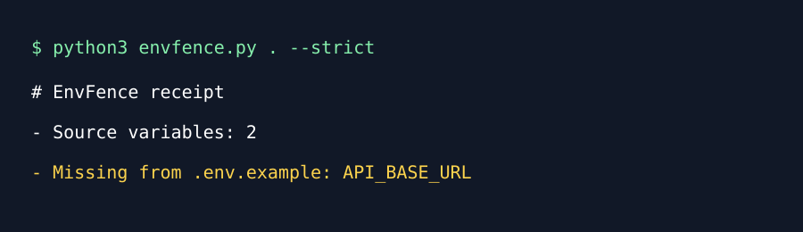

# EnvFence

**A local receipt for environment-variable drift.**

EnvFence finds common Python/JS environment-variable references and compares
them with `.env.example`. It never reads a real `.env`, executes code, or sends
data away.


*Conceptual AI-generated illustration. The SVG below is the truthful CLI demo.*



```sh
python3 envfence.py . --strict
python3 -m unittest discover -s tests -v
```

`--strict` returns 2 if a referenced variable is missing from `.env.example`.
It is a review prompt, not a secrets or deployment audit.
